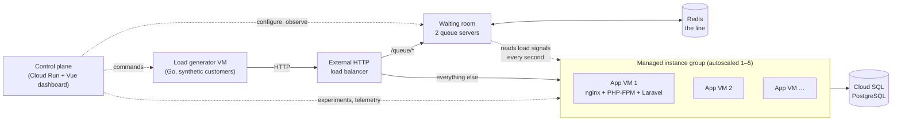
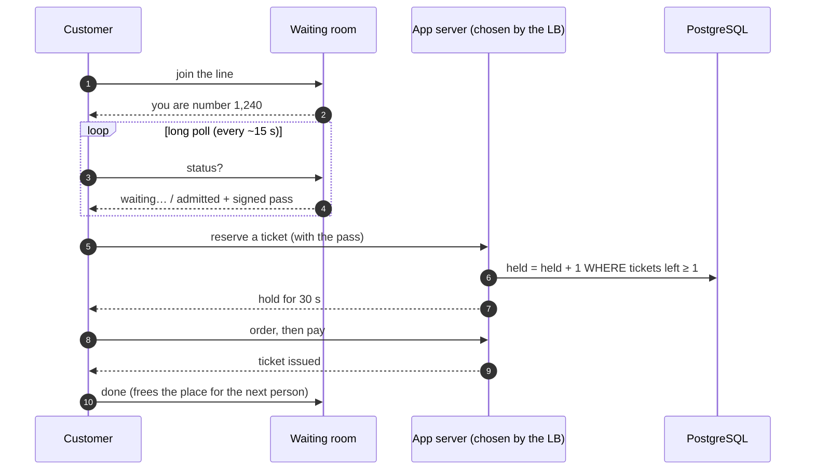

# Ticketing Autoscale Lab

[](https://github.com/mrmacsi/ticketing-autoscale-lab/actions/workflows/ci.yml)

**What happens when 10,000 people try to buy 4,000 tickets in two minutes?**

This repository is a real, end-to-end laboratory that answers that question on Google Cloud. It runs
a genuine ticketing backend, throws thousands of synthetic customers at it, and lets you watch, live,
how the infrastructure reacts: servers being added by the autoscaler, customers waiting their turn in
a waiting room, tickets selling out, and servers being removed again afterwards.

Nothing on the dashboard is simulated. Servers come from the Compute Engine API, CPU from Cloud
Monitoring, traffic from real HTTP responses, and ticket counts from PostgreSQL.

---

## Why this exists

Flash sales (concert tickets, sneaker drops, limited releases) break systems in two ways:

1. **Capacity** — traffic arrives faster than servers can be added. Autoscalers need minutes; a sale
   lasts seconds. Overloaded servers fail health checks and customers see errors.
2. **Correctness** — under heavy contention it is easy to sell the same seat twice.

The lab shows both problems with real measurements, and the techniques that solve them:
CPU-based autoscaling, a **waiting room** with **adaptive admission control**, atomic inventory in
PostgreSQL, and idempotent checkout.

## What it showed (measured in Google Cloud)

The same 2-minute flash sale (5,000 customers, 2,000 tickets) on 1-vCPU servers starting from one, with and without the waiting room (max 3 servers; the run without a waiting room allowed 4):

| | No waiting room | Waiting room, fixed limit | **Waiting room, adaptive limit** |
|---|---:|---:|---:|
| HTTP errors | 21 % (3,469 × `503`) | 0 % | **0 %** |
| Failed purchases | 1,358 | 0 | **0** |
| Tickets oversold | 0 | 0 | **0** |
| App latency p95 | 7.8 s | 0.65 s | **0.41 s** |
| Customers told "sold out" without touching a server | 0 | 2,733 | **2,746** |

Without a waiting room the first server was overwhelmed before the autoscaler's second server could
boot, its health check timed out, and the load balancer had nowhere to send traffic. With the waiting
room, the overflow simply waited in line. Details and more runs (10,000 customers, leader failover):
[`docs/waiting-room.md`](docs/waiting-room.md) and [`PROJECT_GUIDE.md` §12](PROJECT_GUIDE.md).

---

## How it works



| Part | What it does | Code |
|---|---|---|
| **Ticketing API** | A real ticketing backend: browse, hold tickets, order, pay (simulated), issue tickets. Inventory is protected by a single conditional SQL update, so a seat can never be sold twice. | [`apps/ticketing-api`](apps/ticketing-api) (Laravel 13, PHP 8.4) |
| **Waiting room** | A FIFO line in front of checkout. It admits customers only as fast as the servers can take them and tells everyone still waiting when tickets are gone. | [`apps/waiting-room`](apps/waiting-room) (Go) |
| **Load generator** | Thousands of synthetic customers on an open-loop schedule (arrivals don't slow down when the server does). | [`load-generator`](load-generator) (Go) |
| **Control plane + dashboard** | Starts and stops experiments, collects telemetry, builds reports, and shows everything live. | [`apps/control-api`](apps/control-api) (Node/TypeScript), [`apps/dashboard`](apps/dashboard) (Vue 3) |
| **Infrastructure** | VPC, instance group + autoscaler, load balancer, Cloud SQL, Memorystore, Cloud Run, IAM, budget alert. | [`terraform`](terraform) |

### One customer's journey



### The waiting room's adaptive limit

How many customers can a server take at once? It depends on the machine, the code and the database,
so the waiting room **learns it** every second instead of using a fixed number:

* Each app server reports, from nginx (so it answers even when PHP is saturated): requests in flight,
  requests waiting for a PHP worker, and its own CPU.
* **Any server overloaded** (requests queuing, workers ≥ 90 % busy, or CPU ≥ 90 %) → cut the limit
  by 25 %.
* **Every server has headroom** and the room is full → raise it (quickly at first, then by one).
* Capacity = healthy servers × limit, so each server the autoscaler adds raises capacity as soon as
  the load balancer marks it healthy.

This mirrors how TCP finds a network's capacity (slow start, then additive increase / multiplicative
decrease). On a 1-vCPU server the limit settled at ~14 customers in checkout, which cut p95
latency by about 40 % compared with a hand-picked 25. Full design with diagrams: [`docs/waiting-room.md`](docs/waiting-room.md).

---

## Try it locally (free, ~5 minutes)

Requires Docker. Everything runs on your machine; Google Cloud panels show "not available" by design.

```bash
docker compose up -d --build        # Postgres, Firestore emulator, Redis, API, waiting room ×2, control plane, generator
open http://localhost:18081         # dashboard (no sign-in locally)
```

In the dashboard pick preset **F** (10,000 customers, 4,000 tickets, adaptive waiting room), press
**Prepare**, then **Start traffic**, and watch the line grow and drain. Or check correctness directly:

```bash
./scripts/concurrency-test.sh       # 1,000 purchase attempts vs 100 tickets over real HTTP
docker compose down -v              # remove everything
```

## Run it in Google Cloud

> **Costs money.** Idle ≈ $0.50/hour (≈ $12/day) while deployed; ≈ $0.96/hour at peak with 5 app
> servers. Tear it down when you are done. See [`docs/cost-and-cleanup.md`](docs/cost-and-cleanup.md).

1. **Configure.** Copy the example and fill in your own project, account and (optional) billing account:

   ```bash
   cp terraform/environments/autoscaling-lab/terraform.tfvars.example \
      terraform/environments/autoscaling-lab/terraform.tfvars
   export GCP_ACCOUNT=you@example.com GCP_PROJECT=your-project GCP_PROJECT_NUMBER=123456789012
   export GCLOUD="$(command -v gcloud)"   # scripts default to the Homebrew path
   ```

   `terraform.tfvars` is git-ignored. Scripts always pass the account and project explicitly and never
   change your global `gcloud` configuration.

2. **Check, approve, deploy, open the dashboard.**

   ```bash
   ./scripts/gcp-preflight.sh             # read-only: account, billing, permissions, quotas, name conflicts
   ./scripts/approve.sh 5 "50"            # record the approved max servers and monthly budget
   ./scripts/deploy.sh                    # foundation → build & push images → workloads → verify
   ./scripts/dashboard.sh                 # dashboard at http://localhost:8090 (authenticated proxy)
   ```

3. **Run experiments** from the dashboard, or from the terminal:

   ```bash
   ./scripts/start-load-test.sh F --confirm-expensive   # 10,000 customers, 4,000 tickets, waiting room
   ./scripts/stop-load-test.sh                          # hard stop
   ./scripts/monitor-scaling.sh                         # raw autoscaler / instance group / LB state
   ```

4. **Remove everything** this lab created (and nothing else): the **Destroy** panel in the dashboard,
   or `./scripts/teardown.sh --yes`. It verifies that nothing named `ticketing-scale-lab-*` is left
   before disabling the APIs it enabled.

### Experiment presets

| Preset | What it shows |
|---|---|
| **A** Baseline | One server, steady traffic, no scaling. |
| **B** Increasing traffic | Real autoscaling as CPU crosses the target: servers added, joining, serving. |
| **C** Flash sale | Correctness: 1,000 buyers, 100 tickets — exactly 100 sold, the rest get "sold out". |
| **D** Reservation expiry | Abandoned holds expiring and tickets going back on sale. |
| **E** Recovery and scale-in | Scale-out under sustained load, then the autoscaler's slower scale-in. |
| **F** 10,000 customers | A short, huge sale through the adaptive waiting room: 1 → 3 servers, sold out, servers removed about a minute after demand drops. |

---

## Safety built in

* **Spending guard:** deployment refuses to run without a recorded approval of the maximum server count
  and budget; expensive experiment settings need explicit confirmation; a budget alert emails you
  (it is an alert, not a cap).
* **No credentials in code or VM metadata:** database passwords, the admin token and the app key are
  generated by Terraform into Secret Manager and read at runtime. No service-account key files.
* **Private by default:** app servers, waiting room and database have no public IPs; the database
  requires TLS; admin endpoints are reachable only from the control plane's subnet; the dashboard is
  protected by Cloud Run IAM.
* **The generator can only target the lab's own load balancer.**
* **Safe deploys:** `terraform-apply.sh` refuses while an experiment is running and retries transient
  Google API failures, importing anything a dropped connection left half-created.

## Repository map

```text
apps/ticketing-api   Laravel 13 ticketing API (nginx, PHP-FPM, PostgreSQL)
apps/waiting-room    Go queue server: FIFO line, signed admission passes, adaptive admission, Redis HA
apps/control-api     Node/TypeScript control plane: experiments, telemetry, SSE, reports
apps/dashboard       Vue 3 + TypeScript + Tailwind + ECharts dashboard
load-generator       Go traffic generator (open loop, Firestore-controlled)
terraform            modules + the autoscaling-lab environment (state stays local and git-ignored)
scripts              preflight, approve, deploy, plan/apply, build/push, load tests, verify, teardown
docs                 architecture, deployment, experiments, waiting room, costs, failure scenarios, contracts
local                configuration for the local Docker stack
```

## Tests

Every suite runs in CI on each push ([`.github/workflows/ci.yml`](.github/workflows/ci.yml)):

| Suite | Command |
|---|---|
| Waiting room (Go, race detector) | `cd apps/waiting-room && go test -race ./...` |
| Load generator (Go) | `cd load-generator && go test -race ./...` |
| Ticketing API (real PostgreSQL) | `cd apps/ticketing-api && php artisan test` |
| Control API | `cd apps/control-api && npm test` |
| Dashboard | `cd apps/dashboard && npm test` |
| Terraform (mocked providers, no cloud) | `terraform -chdir=terraform/environments/autoscaling-lab test` |
| Deploy/cleanup scripts | `python3 -m unittest discover -s scripts/tests` |

The PHP tests expect PostgreSQL on port 55432:

```bash
docker run -d --name tsl-pg-test -e POSTGRES_USER=lab -e POSTGRES_PASSWORD=secret \
  -e POSTGRES_DB=ticketing_test -p 55432:5432 postgres:16-alpine
```

## Documentation

* [**Project guide** — everything in one document](PROJECT_GUIDE.md)
* [Waiting room and adaptive admission](docs/waiting-room.md)
* [Architecture and decisions](docs/architecture.md)
* [Deployment](docs/deployment.md)
* [Experiment guide](docs/experiment-guide.md)
* [Cost and cleanup](docs/cost-and-cleanup.md)
* [Failure scenarios](docs/failure-scenarios.md)
* [Component contracts](docs/contracts.md)
