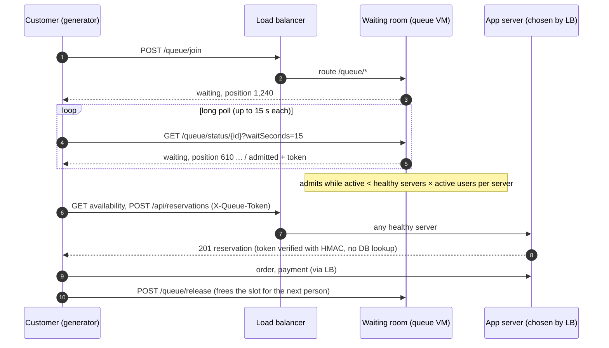
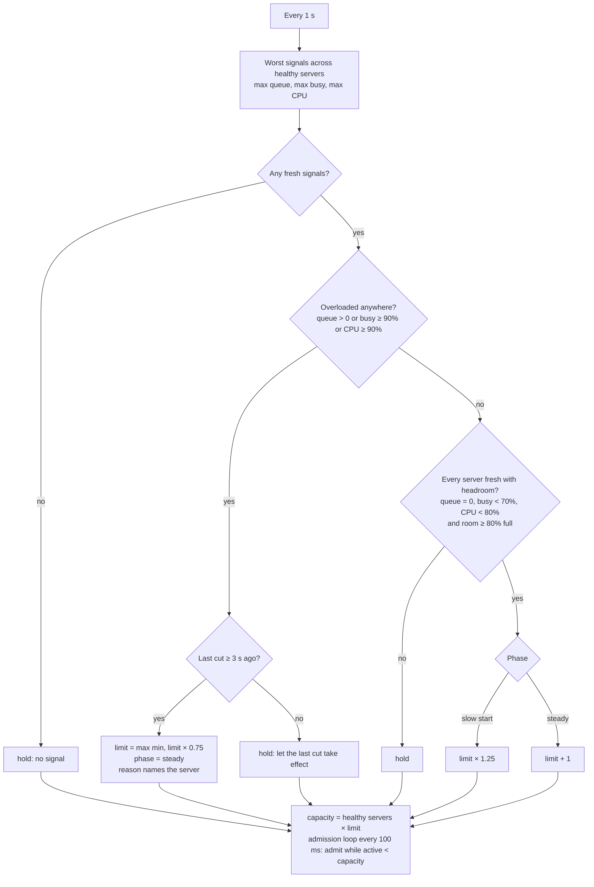
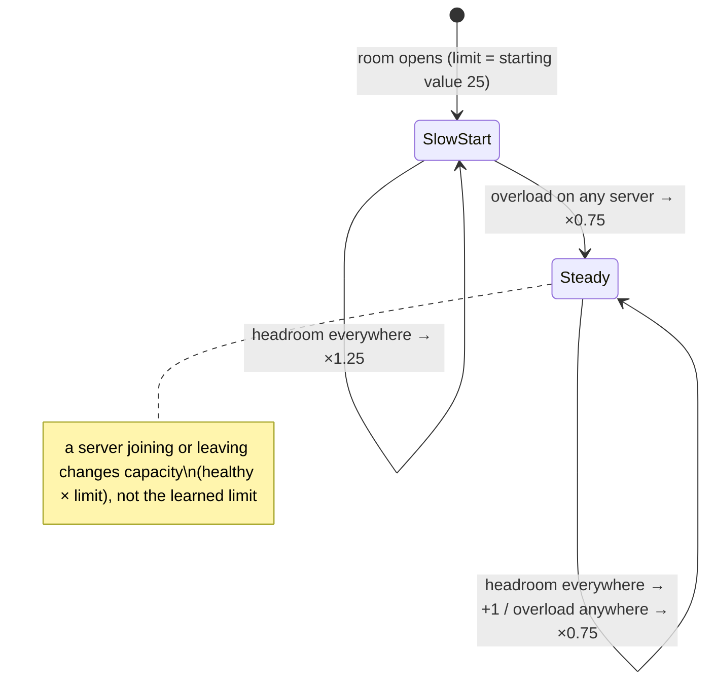

# Waiting room (queue server)

What happens when every server is full? Without a waiting room the answer is: requests pile up on the
servers that exist, latency climbs past the load balancer's readiness probe, the load balancer runs out
of healthy backends and customers get `503 failed_to_pick_backend` (measured in the first fast-scale
run of preset F: 3,469 × 503 in 17 seconds, before the second VM could serve).

With the waiting room, customers who arrive while the servers are full **wait in a FIFO queue** and are
let in only as fast as the servers that the load balancer can actually route to can take them. When the
autoscaler adds a server, capacity grows and the queue drains faster. When tickets are gone, the people
still waiting are told "sold out" without ever touching an application server.

* The **waiting room decides _when_** a customer may start checkout (admission control).
* The **load balancer decides _where_** that customer's requests go (any healthy server).
* The **application enforces** it: `POST /api/reservations` refuses a request without a valid signed
  admission token while the waiting room is in force, so nobody can skip the queue.

---

## 1. Architecture

```text
                                   External Application Load Balancer (http://<ip>)
 load generator VM                 URL map
 (synthetic customers)  ──HTTP──▶   /queue/*  ───────────────▶  waiting-room backend ──▶  queue VM (Go, 1 instance)
                                    everything else ─────────▶  app backend ──┬──▶ app VM 1           │
                                                                             ├──▶ app VM 2           │ every 2 s: LB backend health
                                                                             └──▶ app VM 3 (max)     │   (Compute API getHealth)
                                                                                    ▲                │ every 1 s: availability from a
                                                                                    └────────────────┘   healthy app VM (private IP)
 control API (Cloud Run) ──private IP──▶ queue VM /admin/*  (configure, reset, stats; admin token)
                         ──private IP──▶ app VM /api/admin/settings  (waiting_room_required on/off)
```



### Why a separate VM behind the same load balancer

| Option | Verdict |
|---|---|
| Queue inside the Laravel app, state in PostgreSQL | Rejected: thousands of waiting customers polling would hit the 1-vCPU database and the very servers that are full. |
| Cloud Run service | Rejected: needs a serverless NEG and public invoker IAM the deploying account cannot grant; FIFO state must be single-instance anyway. |
| **Dedicated small VM, in-memory FIFO, `/queue/*` path rule on the existing LB** | **Chosen.** One process is the single source of truth for order; long polling keeps thousands of waiters cheap; same host for the generator (its target allowlist is unchanged); reachable privately by the control plane. |

The queue VM is a single point of failure by design (lab scope). If it restarts, the queue is lost and
customers must re-join; tokens already issued stay valid until they expire because verification is
stateless.

---

## 2. Admission rules

* `capacity = healthyServers × activeUsersPerServer` where `healthyServers` is the number of app VMs the
  **load balancer** reports `HEALTHY` (not merely running). Zero healthy servers ⇒ capacity 0 ⇒ nobody
  is admitted (people wait instead of getting 503).
* `active` = admitted customers who have neither released their slot nor passed `admissionTtlSeconds`
  since admission (abandoned browsers cannot hold a slot forever).
* Every 100 ms, while `active < capacity` and the room is not sold out, the head of the queue is admitted.
  Strict FIFO by join order.
* **Inventory:** every second the queue reads `GET /api/events/{id}/availability` (tickets `available`
  and `held` in other customers' checkouts) from a healthy app VM.
  * It never admits more customers per observation than there are `available` tickets. Near the end of a
    sale an expired hold returns one ticket at a time; without this budget the room would let a full
    batch of 25–50 customers in to fight over one ticket (measured in the first local run: 4,362 admitted
    for 2,000 tickets).
  * While `available == 0` it stops admitting but keeps people waiting: held tickets may come back.
  * `available == 0 and held == 0` ⇒ **sold out at once**: every waiting customer gets `sold_out` and new
    joins are told immediately. (If an app does not report `held`, the room falls back to waiting
    `soldOutGraceSeconds` — reservation TTL + 5 s — of continuous zero availability.)
  * Sold out is final until the room is reset.
* **People who leave are dropped.** Anyone in line who has not checked in (joined or polled) for
  `waitingTimeoutSeconds` (default 45 s, longer than the 25 s maximum long poll) is removed once a
  second, counted in `abandonedTotal`, and never admitted; if they come back their id is unknown and they
  re-join at the back. Without this, the first adaptive run in Google Cloud kept 2,700 people who had
  already gone (the generator stopped) and trickled them into checkout one per returned ticket.
* A customer who joins when the room is disabled gets status `open` (no queue in force; proceed without a
  token).

`activeUsersPerServer` (default 25) is sized from measurement: one `n1-standard-1` serves about 100–120
req/s; an uncontended purchase journey is 4 requests in about 1 s, so ~25 journeys in flight per server
keeps a VM busy (CPU high enough for the autoscaler) without starving its readiness probe.

---

## 2a. Adaptive admission (how many customers can a server take?)

A fixed "25 customers per server" is only right for one machine type and one workload. CPU alone is a
poor gate: Cloud Monitoring CPU arrives 1–4 minutes late, it misses non-CPU bottlenecks (database,
locks, sleeping workers), and if the room admitted only below the autoscaler's CPU target the autoscaler
would never scale. In **adaptive mode** the room learns each server's limit from fast signals the server
reports about itself, the way TCP finds a network's capacity (slow start, then
additive-increase / multiplicative-decrease) and the way Netflix concurrency-limits and Envoy's adaptive
concurrency protect services.

### Signals (per healthy server, every second, never through the busy worker pool)

| Signal | Where it comes from | Why it matters |
|---|---|---|
| **Workers busy** = requests in flight / PHP workers (capped at 100 %) | `GET /lab/load` → nginx `stub_status` ("Writing" = requests being processed) and the worker count in the `X-Php-Workers` header | Little's law: requests in flight = throughput × time per request, so this rises for *any* bottleneck (CPU, database, locks, payment delays) |
| **Listen queue** = requests in flight beyond the worker count (waiting for a free worker) | same | Anything > 0 means the server is already overloaded: requests are queuing, latency is climbing |
| **VM CPU** (sampled every 2 s inside the VM) | `GET /lab/cpu` → the sampler's file, served by nginx | CPU-bound protection; seconds old, not minutes |

Both endpoints are served by nginx without PHP and only to VPC addresses (`LOAD_ALLOW_CIDRS`); through
the load balancer they return 403.

Measured on the local stack (16 PHP workers, each request burning 200 ms of CPU):

| Concurrent requests | In flight reported | Busy | Waiting for a worker | Signal response time |
|---:|---:|---:|---:|---:|
| 4 | 4 | 25 % | 0 | 2–4 ms |
| 8 | 7–8 | 44–50 % | 0 | 2–3 ms |
| 12 | 9–12 | 56–75 % | 0 | 1–3 ms |
| 64 | 62–63 | 100 % | 46–47 | 1–2 ms (app requests meanwhile: 0.74 s) |

PHP-FPM's own status page was tried first and rejected: served from a separate status listener
(`pm.status_listen`, so it answers when the pool is full) it reported impossible worker counts
(e.g. 24 busy of 24 with 4 requests on a 16-worker pool, 85 of 85 under saturation).

### Controller (every second): one shared limit, set by the busiest server

The load balancer gives every healthy server the same share of requests, whatever "limit" each
server has, so the limit that matters is **customers in checkout per healthy server**, and it must
suit the busiest server. capacity = healthy servers × limit.

The first adaptive version kept a separate limit per server. Measured in Google Cloud, identical VMs
drifted apart (7 and 39): server 1 also carried load from customers admitted on server 2's limit and
was cut for it. A new server slow-started from 25 and overshot on a cold VM (p95 2 s). One shared limit
fixes both: decisions use the worst signal of any server, and a new server joins at the learned value.





The result is a sawtooth just under what the busiest server can take. A bigger machine type (or more
PHP workers) gets a higher limit without anyone changing a number; a database slowdown lowers it.
Heterogeneous pools behind a round-robin balancer are limited by their weakest member — which is
exactly what that balancer forces anyway.

### Why the two control loops do not fight

| Loop | Signal | Acts on | Time scale | Threshold |
|---|---|---|---|---|
| Autoscaler | Cloud Monitoring CPU (60 s samples, 1–4 min late) | number of servers | minutes | CPU target (30 % in preset F) |
| Waiting room | workers busy, listen queue, VM CPU (1–2 s) | customers admitted | seconds | busy 90 %, CPU 90 % |

The room only holds servers back *above* the autoscaler's target, so a busy server still pushes the
autoscaler to add servers, and each new server adds its own limit to the room's capacity.

### Guards

* Increase only when the room is at least 80 % full (active ≥ 0.8 × capacity). "People waiting" is not
  enough: near a sell-out they wait for *tickets*, not capacity. The first local run did exactly that
  (an idle server's limit climbed 14 → 130 while 2,000 people waited for returned holds) before this
  rule was tightened.
* After a cut, no further cut for 3 s: customers already inside need time to finish.
* Limits stay within `[minPerServer, maxPerServer]` (default 5–200).
* No fresh signals for a server ⇒ its limit is held (not increased); a server that leaves the LB's
  healthy set leaves the capacity at once.
* Fixed mode (`admissionMode: "fixed"`) keeps the previous behaviour: healthy servers × `activeUsersPerServer`.

## 3. Contracts

### 3.1 Queue server public API (through the load balancer, prefix `/queue/`)

Every response has `X-Served-By: waiting-room` and `Cache-Control: no-store`. Error body shape is the same
as the ticketing API: `{"error": "<code>", "message": "<text>"}`.

**Status object** (`data` of join and status responses):

```json
{
  "queueId": "q_01J9...",            // opaque, unguessable (128-bit random, base32/hex)
  "eventId": "<uuid>",
  "status": "waiting | admitted | sold_out | open",
  "position": 1240,                    // 1-based place in line while waiting, 0 otherwise
  "waiting": 3110,                     // total currently waiting
  "estimatedWaitSeconds": 42,          // position / recent admission rate (null when unknown)
  "token": "v1.<payload>.<sig>",       // only when admitted
  "tokenExpiresAt": "2026-10-10T15:00:00.000Z",  // only when admitted
  "pollAfterMs": 0                     // hint for clients that do not long-poll
}
```

| Method & path | Body / query | Response |
|---|---|---|
| `POST /queue/join` | `{"eventId": "<uuid>", "customerRef": "<string ≤ 100>"}`. Same `customerRef` + event while still waiting/admitted returns the same entry (safe retry). | 200 `{data: Status}`; 400 `invalid_request`; 404 `unknown_event` when the room is enabled for a different event |
| `GET /queue/status/{queueId}?waitSeconds=N` | `N` 0–25 (default 0). Long poll: returns as soon as the status is no longer `waiting`, or after N seconds with the current position. | 200 `{data: Status}`; 404 `unknown_queue_id` |
| `POST /queue/release` | `{"queueId": "...", "outcome": "purchased | sold_out | abandoned | failed"}` | 200 `{data: {"released": true}}` (idempotent; unknown id also 200 with `released: false`) |
| `GET /queue/health` | — | 200 `{"status":"ok"}` (LB health check) |

### 3.2 Admission token

```text
token   = "v1." + b64url(payloadJSON) + "." + b64url(HMAC_SHA256(signingKey, "v1." + b64url(payloadJSON)))
payload = {"q": "<queueId>", "e": "<eventId>", "exp": <unix seconds>}
signingKey = HMAC_SHA256(key = LAB_ADMIN_TOKEN, message = "waiting-room-token-v1")   // raw 32 bytes
```

b64url is base64 URL alphabet **without padding**. Both sides derive the signing key from the lab admin
token (already in Secret Manager for both), so no new secret is introduced. `exp = admittedAt +
admissionTtlSeconds`.

### 3.3 Ticketing API enforcement

* New lab setting `waiting_room_required` (boolean, default `false`) through the existing
  `PUT /api/admin/settings`.
* When true, `POST /api/reservations` requires header `X-Queue-Token`. Checked **before** idempotency
  replay and before any database work:
  * missing → `403 {"error":"queue_token_required"}`
  * bad format/signature → `403 {"error":"queue_token_invalid"}`
  * `exp` in the past → `403 {"error":"queue_token_expired"}`
  * `e` ≠ the event of the requested `category_id` → `403 {"error":"queue_token_wrong_event"}` (this
    check may be done in the controller where the category is loaded).
* Orders and payments are not gated: they can only continue a reservation that was already admitted.

### 3.4 Queue server private API (VPC only — the LB never routes `/admin/*` to it)

All require `Authorization: Bearer <LAB_ADMIN_TOKEN>`; 401 otherwise.

| Method & path | Body | Response |
|---|---|---|
| `PUT /admin/config` | `{"enabled": bool, "eventId": "<uuid>", "activeUsersPerServer": 1..1000, "admissionTtlSeconds": 10..3600, "soldOutGraceSeconds": 0..3600, "admissionMode": "fixed" \| "adaptive", "waitingTimeoutSeconds": 0 \| 30..3600, "adaptive": {"minPerServer": 1..1000, "maxPerServer": 1..1000, "busyHigh": 0..1, "busyLow": 0..1, "cpuHigh": 0..1, "cpuLow": 0..1, "decreaseFactor": 0.1..0.99, "slowStartFactor": 1.01..4, "cooldownSeconds": 0..60}}` (partial bodies keep omitted values; `adaptive` merges field by field). In adaptive mode `activeUsersPerServer` is the starting limit of each new server. A different `eventId` (or `enabled:false`) clears the queue, counters and learned limits. | 200 `{data: Config}` |
| `POST /admin/reset` | — | 200; clears queue, active set, counters; keeps config |
| `GET /admin/stats` | — | 200 `{data: Stats}` |

```json
Stats {
  "enabled": true, "eventId": "<uuid>", "soldOut": false,
  "waiting": 3110, "active": 75, "capacity": 75,
  "healthyServers": 3, "servers": [{"name": "ticketing-scale-lab-app-ab12", "ip": "10.60.0.9"}],
  "activeUsersPerServer": 25,
  "joinedTotal": 4200, "admittedTotal": 1090, "releasedTotal": 1015, "expiredTotal": 0, "soldOutTotal": 0,
  "admissionRatePerSecond": 24.5,            // admissions over the last 10 s
  "waitMs": {"p50": 8000, "p95": 41000, "max": 52000, "count": 1090},   // join → admitted, admitted customers
  "oldestWaitingSeconds": 48.2,
  "inventory": {"available": 812, "held": 40, "soldOut": false, "observedAt": "..."} | null,
  "capacitySource": "gce | static", "capacityError": null | "<last error>",
  "admissionMode": "fixed | adaptive",
  "abandonedTotal": 12, "waitingTimeoutSeconds": 45,
  "adaptive": {"minPerServer": 5, "maxPerServer": 200, "busyHigh": 0.9, "busyLow": 0.7, "cpuHigh": 0.9, "cpuLow": 0.8,
               "decreaseFactor": 0.75, "slowStartFactor": 1.25, "cooldownSeconds": 3},
  // servers[] gains, per server:
  //   "limit": 31, "phase": "slow_start | steady | fixed",
  //   "decision": "increase | decrease | hold", "reason": "listen queue 4" | "headroom" | "no signal" | ...,
  //   "decisionAt": "...", "decreases": 3,
  //   "signals": {"busy": 0.81, "activeWorkers": 26, "totalWorkers": 32, "listenQueue": 0,
  //               "cpu": 0.74, "cpuSampledAt": "...", "observedAt": "..."} | null
  //   (activeWorkers = min(in flight, workers); listenQueue = in flight beyond the worker count)
  "updatedAt": "..."
}
```

### 3.5 Queue server configuration (environment)

| Variable | Meaning |
|---|---|
| `PORT` | listen port (default 8080) |
| `LAB_ADMIN_TOKEN` or `LAB_ADMIN_TOKEN_SECRET` | admin token, or Secret Manager resource name read at start via the metadata-server token |
| `CAPACITY_SOURCE` | `gce` (LB backend health) or `static` |
| `GCP_PROJECT_ID`, `BACKEND_SERVICE_NAME`, `INSTANCE_GROUP_URL` | for `gce`: `POST compute/v1/projects/{p}/global/backendServices/{bs}/getHealth` with `{"group": INSTANCE_GROUP_URL}` |
| `STATIC_BACKENDS` | for `static`: comma-separated base URLs (e.g. `http://ticketing-api:8080`); a backend counts as healthy while `GET /health` answers 200 |
| `APP_PORT` | app port on VM private IPs (default 8080) |
| `CAPACITY_POLL_MS` / `INVENTORY_POLL_MS` | defaults 2000 / 1000 |
| `SIGNAL_POLL_MS` / `CONTROL_INTERVAL_MS` | defaults 1000 / 1000 (adaptive mode: per-server load signals and controller step) |

### 3.5a Ticketing API load endpoints (VPC only, served by nginx without PHP)

| Method & path | Response |
|---|---|
| `GET /lab/load` | nginx `stub_status` text (`Active connections: 40 … Reading: 0 Writing: 37 Waiting: 3`) with header `X-Php-Workers: 32`. In flight = Writing − 1 (the status request itself). |
| `GET /lab/cpu` | `{"percent": 74.2, "sampled_at": "2026-10-10T17:22:01Z"}` (VM CPU, sampled every 2 s) |

Allowed only from `LOAD_ALLOW_CIDRS` (the workloads and control subnets); 403 otherwise, including
everything arriving through the load balancer.

### 3.6 Generator

* `TrafficConfig.waitingRoom = {"enabled": bool}` (absent ⇒ false).
* Env `QUEUE_BASE_URL` (default `TARGET_BASE_URL`); its host must also be in `ALLOWED_TARGET_HOSTS`.
* When enabled, **reserve and purchase journeys** become: join → long-poll status (`waitSeconds=15`)
  until not waiting → if `sold_out`: end (outcome `sold_out_in_queue`) → if `admitted`/`open`: run the
  normal checkout, sending `X-Queue-Token` on `POST /api/reservations` → always `POST /queue/release` with
  the outcome. Browse/availability journeys never queue.
* A waiting customer occupies a VU (it is a customer in flight). Queue HTTP failures are retried with
  backoff (1 s, 2 s, 4 s … max 5 s) until the journey's overall deadline (`durationSeconds` + 30 s grace).
* Queue calls are **not** counted in the bucket's `requests`, latency histogram, `byEndpoint` or
  `byInstance` (those describe the app servers). They go in a new `queue` object on each 1 s bucket:

```json
"queue": {
  "joined": 40, "admitted": 25, "soldOut": 0, "open": 0, "failed": 0,
  "waiting": 1830,                        // gauge: customers waiting at the end of this second
  "waitMs": <histogram, same format as latency>,  // join → admitted, recorded at admission
  "requests": {"total": 130, "ok": 130, "errors": 0}
}
```

### 3.7 Control plane

* `ExperimentConfig.waitingRoom = {"enabled": bool, "activeUsersPerServer": int, "admissionTtlSeconds": int,
  "mode": "fixed" | "adaptive", "maxUsersPerServer": int}` (`mode` default `fixed`; `maxUsersPerServer`
  default 200, only used in adaptive mode; sent to the queue as `admissionMode` and `adaptive.maxPerServer`)
  (default disabled; presets A–E disabled; **F enabled, adaptive**, starting limit 25, max 200, 60 s TTL).
* Prepare: `PUT /admin/config` on the queue (eventId of the new event, `soldOutGraceSeconds =
  reservationTtlSeconds + 5`) and `waiting_room_required` on the app; disabled ⇒ both off. Complete,
  reset and failure turn both off.
* Telemetry: poll `GET /admin/stats` every 1 s (freshness live ≤ 3 s) → `LiveSnapshot.waitingRoom`;
  generator `queue` buckets aggregated into the traffic view and series.
* Timeline events (from successive observations only): "Waiting room opened: N customers waiting",
  "Waiting room capacity 25 → 50 (2 healthy servers)", "Waiting room empty", "Waiting room declared sold
  out: N customers told".
* Report `measured.waitingRoom`: joined, admitted, soldOutInQueue, peakWaiting, wait p50/p95/max,
  peak capacity.
* Dashboard: a **Waiting room** panel (waiting, active / capacity, healthy servers, admission rate,
  wait p50/p95, sold out) and a chart of waiting vs admitted vs capacity over time; a toggle and
  "active users per server" field in the configuration form.

---

## 4. Preset F with the waiting room — measured in Google Cloud (2026-10-10)

Configuration: 1 → max **3** servers, CPU target 30 %, 2,000 tickets, 30 s holds, 10 % checkout
abandonment, 5,000 customers at 42/s (the 5,000th arrives at about 119 s), waiting room on with 25
active customers per healthy server. Experiment `exp_20261010_172055_a367`; raw data in
`outputs/waiting-room-2026-10-10/`.

| t (s) | What happened |
|---:|---|
| 0 | Waiting room opens; server 1 at 25/25 customers, the rest queue |
| 34 | Autoscaler 1 → 2 |
| 59 | Autoscaler 2 → 3 |
| 83 | Server 2 healthy in the LB → room capacity 25 → 50 |
| 110 | Server 3 healthy → capacity 50 → 75 (all 5,000 have joined; 2,303 waiting) |
| 85–147 | Tickets all sold or held: admissions paused, then trickled one customer per returned hold |
| 149 | `available = 0, held = 0` → **sold out declared: 2,733 waiting customers told** |
| 393–399 | Scale-in 3 → 2 → 1 |

| Measure | Without waiting room (same preset, earlier run) | With waiting room |
|---|---:|---:|
| HTTP errors | 21 % (3,469 × 503) | **0 %** |
| Failed purchases | 1,358 | **0** |
| Tickets sold | 1,988 | **2,000** |
| App latency p95 | 7.8 s | **0.65 s** |
| Customers told "sold out" without hitting the app | 0 | **2,733** |
| Invariant violations | 0 | 0 |
| Peak waiting | — | 2,743 |
| Time in queue p50 / p95 / max | — | 20 s / 39 s / 94 s |

**Reading it honestly:** the waiting room is what removed the errors; the extra servers arrived when the
sale was nearly over (server 1 served 96 % of app requests). At 25 customers per server, one
`n1-standard-1` sells ~22 tickets/s, so 2,000 tickets take ~90 s, about the same as the autoscaler's
reaction plus VM boot time. A larger sale (more tickets, or a longer arrival window) is where servers 2 and
3 would carry real traffic; the room's capacity already follows them automatically.

### Fixed vs adaptive, measured in Google Cloud (same preset F, 1 → max 3 `n1-standard-1`)

| | Fixed 25 | Adaptive, per-server limits | **Adaptive, shared limit** (current) |
|---|---:|---:|---:|
| HTTP errors | 0 % | 0 % | **0 %** |
| App latency p50 / p95 / p99 | 117 / 653 / 1,051 ms | 73 / 790 / 1,693 ms | **66 / 405 / 869 ms** |
| Peak VM CPU (Cloud Monitoring, 60 s) | 77 % | 77 % | 66 % |
| Learned limit per server | 25 (set) | 7, 39, 25 (drifted apart) | **14 on every server** |
| Tickets sold / failed purchases / violations | 2,000 / 0 / 0 | 2,000 / 0 / 0 | 2,000 / 0 / 0 |
| Told "sold out" in the queue | 2,733 | 2,741 | 2,746 |
| Time in queue p50 / p95 | 20 s / 39 s | 32 s / 48 s | 30 s / 48 s |
| Sold out declared at | t+149 s | t+174 s | t+192 s |

Experiments: `exp_20261010_172055_a367` (fixed), `exp_20261010_200934_1b48` (per-server),
`exp_20261010_202657_d839` (shared); exports in `outputs/waiting-room-2026-10-10/` and
`outputs/adaptive-2026-10-10/`.

**What the numbers say.** On a 1-vCPU VM the controller settles at ~14 customers in checkout per
server, not 25: VM CPU is the binding signal (it cuts at 90 %). That halves p95 latency (653 → 405 ms)
and p99 (1,051 → 869 ms) at the cost of ~25 % less throughput, so the sale takes ~40 s longer and people
wait ~10 s more. The thresholds (busy 90 %, CPU 90 %) are the real policy knob — how hot servers may
run — not a customer count. The shared limit beat per-server limits on every latency figure: no cold-VM
slow-start overshoot, no limits drifting apart under an even load balancer.

### How to run it

```bash
./scripts/start-load-test.sh F --confirm-expensive
```

or press **F** in the dashboard presets. The **Waiting room** panel and chart show waiting, active /
capacity and healthy servers live; the report has a `waitingRoom` section.
